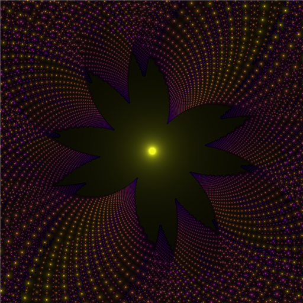
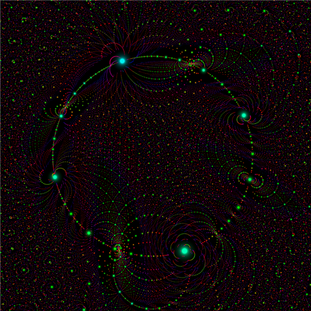
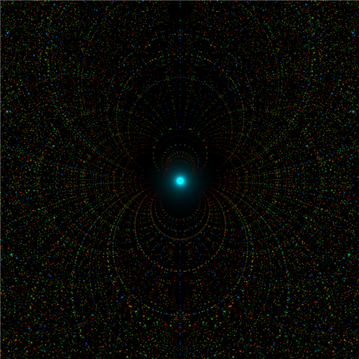

# Algebraic Fractals

Pictures of the complex plane that show where the **algebraic numbers** are: the roots of polynomials with whole-number coefficients, like `x² − 2` (root √2) or `3x³ + x − 1`. With the degree and coefficient sizes limited, these roots form star fields, lace, flowers and spirals that keep going at every zoom level. **Algebraic Fractals** lets you explore them, save the views you like, and turn them into smooth zoom videos.

<p>
  
  
  
</p>

*Left: cubic numbers around (1 + i√2)/3, a root of 3x² − 2x + 1. Middle: a deep zoom at order 3 with coefficients up to 1115. Right: order 10 with coefficients up to 3, near −0.826i.*

## Download

Get the latest version from the [Releases page](https://github.com/sambotron080/algebraic-fractals/releases/latest):
- **Windows 10/11 (64-bit):** `AlgebraicFractals-<version>-windows-x64.zip`. Unzip it anywhere and double-click **Algebraic Fractals.exe**. Nothing needs installing. Windows may warn that the program is unsigned: click **More info → Run anyway**.
- **macOS 11 or later** (Apple silicon and Intel): `AlgebraicFractals-<version>-macos.zip`. The first time, macOS blocks it until you allow it: see [MAC.md](docs/MAC.md).

## Quick start

1. Click on the picture to choose where to zoom, and press **Enter** (or double-click). The mouse wheel sets how far each zoom goes.
2. Tick **auto** next to **Max coefficient**, so the stars stay equally dense however deep you go.
3. Press **⭐ Save location** for views you like, filing them in a group in the order a video should visit them.
4. In **📂 Locations...**, press **🎬 Make video** on the group, then **Render now**.

The [user guide](docs/USER-GUIDE.md) explains everything.

## What it does

**The explorer** (the main window):
- click to zoom, with the order, max coefficient, root density and resolution always on screen, and the rest in popups;
- recolour instantly, with 23 colormaps and image-editing sliders;
- predict how dense the stars will be before rendering, and choose the order or max coefficient to keep that density steady as you zoom;
- hover to see the polynomial behind every point;
- save PNGs, and save locations in groups.

**The video window:**
- a path from a start, through any number of waypoints, to a finish: taken from a group of locations, or added from the explorer's view;
- a small render of every waypoint, always in view, that updates as you change the settings;
- each waypoint's max coefficient chosen automatically or by hand, with the frames between following a smooth curve and new stars fading in; or **keep flower size** to dive into a flower while it stays the same size on screen;
- one colouring for the whole video, with the brightness and the length/height colour scale held steady if you like;
- fast: each part of the plane is rendered once and shared by the frames that show it (about 6 times faster for zooms), and deep views share one search per tile of pixels, so a 720p frame 10⁻⁷ wide with coefficients up to 3000 takes a fraction of a second;
- MP4 (H.264) and/or PNG frames, up to 4K, with optional anti-aliasing;
- projects that save every setting, to render now, later, or from the command line.

**The command line**, `algfrac`, renders single images (and their raw data) for scripts or very large renders, and renders saved video projects.

## What is computed

For each pixel `X` of a region of the complex plane, the program finds the **residual**

```
residual(X) = min |c0 + c1·X + c2·X² + … + cn·Xⁿ|
```

over every polynomial up to a chosen **order** `n`, with integer coefficients up to a chosen **max coefficient** `M`. It also records which polynomial gives that minimum. The residual is 0 exactly at a root, and small near one, so plotting `1/residual` or `−log(residual)` lights up every algebraic number that fits within those limits as a glowing point. Other options restrict the coefficients to sparser sets (primes, Fibonacci numbers, odd numbers, triangular numbers, squares, cubes or powers of 2), or forbid zeros.

There are `(2M+1)^(n+1)` polynomials to try at every pixel: about 10⁹ for order 4 with `M = 32`. The program doesn't try them one by one. It splits each polynomial into a low half and a high half, so that `|p(X)|` becomes the distance between two points in the plane. Finding the smallest residual then becomes a closest-pair search, which a spatial grid answers quickly. Two neighbouring coefficients are solved for directly, as the nearest point of a lattice. As a result, a 256 × 256 image at order 4 with `M = 32` takes under a second and about 5 MB of memory. The details are in [How the search works](docs/DEVELOPER.md#how-the-search-works).
## Why the patterns look the way they do

Each bright point is an algebraic number: a root of one of the allowed polynomials. The structure comes from how these numbers repel and organise each other, depending on how *simple* they are. Low degree and small coefficients count as simple. This is studied mathematics: see the [references](#further-reading) below, particularly *Algebraic Number Starscapes*, which is about images very like these.

### Simple numbers push others away: the dark holes

Take two algebraic numbers: α, a root of p, and β, a root of q. Their **resultant** Res(p, q) is a whole number built from the two polynomials' coefficients. It is also, up to a factor, a product of differences between their roots, and α − β is one of those differences. If α ≠ β, the resultant is a nonzero integer, so its size is at least 1. That stops α coming arbitrarily close to β:

```
|α − β|  ≳  1 / ( H(p)^deg(q) · H(q)^deg(p) )        H = height = largest |coefficient|
```

The simpler β is, the larger the empty region around it. That's why 0, ±1, ±i, the roots of unity, ½ ± (√3/2)i and similar numbers sit in dark holes. The edges of the holes are the most intricate places, because the numbers that come closest are packed in a very particular way.

The **dark band along the real axis** is the same effect, applied to a number and its own mirror image. The complex roots of a polynomial with real coefficients come in conjugate pairs α and ᾱ, so a root just above the axis has a twin just below it. Two roots of one polynomial can't be too close, because the polynomial's **discriminant** is a nonzero integer. Real roots don't have a twin, so they pile up into the bright line *on* the axis.

### Flowers: an inverted lattice around each quadratic number

Take a quadratic number β: a root of some ax² + bx + c, for example i, a root of x² + 1. If a cubic p has a root α near β, then to first order

```
α ≈ β − p(β) / p′(β)
```

β² can be rewritten in terms of β and 1, so p(β) and p′(β) both have the form (u + vβ)/a^k, with integers u and v. Numbers of that form lie on a **lattice**: a skewed grid of points in the complex plane. So the stars around β are approximately β − λ/μ, with λ and μ both from a lattice.

Dividing by μ is an **inversion** (z → 1/z), and inversion sends every straight row of lattice points to a circle through β:
- Each family of parallel rows becomes a family of circles touching at β. These are the petals.
- The lattice's different row directions give the different sets of petals.
- Different λ give rotated and scaled copies of the flower, because multiplying by a complex number rotates and scales. When the rotation turns steadily as the copies shrink, they line up into **spiral** arms. This explanation of the spirals is a heuristic. It hasn't been checked carefully against renders.

Each quadratic number has its own lattice, so each flower is different. The left image above is the flower around (1 + i√2)/3.

**The flower's size.** λ can't come closer to 0 than the lattice allows, but |μ| = |p′(β)| grows with the max coefficient M. So the dark middle of the flower is about constant / M across: double M and it halves, keeping exactly its shape. Zooming in by the same factor as M grows keeps the flower the same size on screen, while the stars around it get about 4× denser per doubling. A video's **keep flower size** setting does this.

### Why order 3 is special

- **Order 2 is rigid.** The complex roots of a quadratic, (−b ± i√(4ac − b²)) / 2a, always have a *rational* real part −b/2a. So every one of them sits on a vertical line at a fraction.
- **Order 3 is the first free order.** A cubic with a complex pair of roots also has one real root r. The real part of the pair is (s − r)/2, where s = −b/a is rational and r is usually irrational, so the stars leave the lines. But there are few enough cubics that they still arrange themselves around the quadratic numbers, as their flowers. An order-3 image shows the structure of the quadratic numbers, drawn by the cubics around them.
- **Higher orders become texture.** Many more polynomials fill the plane and drown out the individual flowers. The roots also drift towards the unit circle |z| = 1: by theorems of Erdős–Turán and Bilu, the roots of polynomials with small coefficients spread evenly around it as the degree grows. Near the circle, with tiny coefficients, a different structure appears: lacy fractals like the "dragon" sets of iterated function systems.

### Symmetries: every region is different, but motifs recur

The stars have only a few **exact** symmetries. Each of these maps the allowed polynomials onto other allowed polynomials:
- mirroring across the real axis (conjugation);
- z → −z, which mirrors left to right (the odd coefficients change sign);
- z → 1/z (the coefficients are reversed), which makes the inside of the unit circle an inverted copy of the outside. The star positions match exactly, but their glows are resized, so the images don't look identical.

There's also a much larger **approximate** symmetry: the maps z → (az + b)/(cz + d) with whole numbers a, b, c, d and ad − bc = ±1. Each sends a polynomial of degree n to another of degree n, but usually with larger coefficients. So the structure around i reappears around i + 1, 1/(i + 2) and so on, distorted and thinner, because some of its polynomials now have coefficients over the limit. That's why motifs recur across the plane but are never quite identical.

### Star size and brightness

Near a root α of p, the residual is about |p′(α)| · |X − α|. So each star's glow has a radius roughly proportional to 1/|p′(α)|. Polynomials that cross zero gently give large soft stars, and steep ones give pinpricks.

### Density: the sweet spot

How an image looks depends mostly on how many algebraic numbers fall in each pixel. Too few, and it's a scatter of isolated dots. Too many, and the stars merge into noise. Around 4 per 100 square pixels gives a fine, even star field.

This density can be predicted before rendering. The number of allowed polynomials of each degree is easy to count. The **Kac–Rice formula** gives the expected density of roots of a random polynomial at each point of the plane. A correction, measured by solving a few thousand random allowed polynomials, accounts for how integer coefficients confine the roots. Multiplying these and integrating over the view gives the expected number of stars, usually to within about 20%. The app shows this prediction (the *root density*) and can set the order or max coefficient to hold it at a chosen value as you zoom. See [Predicting the density](docs/DEVELOPER.md#predicting-the-density-densityrs) for the details.

### Further reading

- John Baez, *The Beauty of Roots* (2011): an essay on pictures of the roots of polynomials with small coefficients, and the fractals near the unit circle.
- Edmund Harriss, Katherine Stange and Steve Trettel, *Algebraic Number Starscapes* (arXiv, 2020): the holes, flowers and approximate symmetries of these images, studied in detail.
- Andrew Odlyzko and Bjorn Poonen, *Zeros of polynomials with 0, 1 coefficients* (L'Enseignement Mathématique, 1993): the fractal structure of roots near the unit circle.
- P. Erdős and P. Turán (1950) and Yuri Bilu (1997): why roots of polynomials with small coefficients spread evenly around the unit circle.
- The Kac–Rice formula for the expected density of roots of random polynomials: e.g. Shepp and Vanderbei, *The complex zeros of random polynomials* (1995).

## Building from source

The program is written in Rust. On Windows, run `powershell -ExecutionPolicy Bypass -File build.ps1` (it needs Rust's GNU toolchain and MinGW-w64); on a Mac, `bash build-mac.sh`. Elsewhere, `cargo build --release` should work. [DEVELOPER.md](docs/DEVELOPER.md) describes the requirements, the source layout and how the search works. Pushing a version tag builds both downloads on GitHub ([.github/workflows](.github/workflows)).

## Licence

Licensed under either of the [MIT licence](LICENSE-MIT) or the [Apache License, Version 2.0](LICENSE-APACHE), at your option.

The video encoder, Cisco's [OpenH264](https://github.com/cisco/openh264), is compiled in from its BSD-licensed source. H.264 itself is covered by patents, and Cisco's patent licence covers only Cisco's own prebuilt OpenH264 binaries, not builds like this one. For personal, non-commercial use this is rarely a concern; for commercial distribution, check the rules that apply to you.